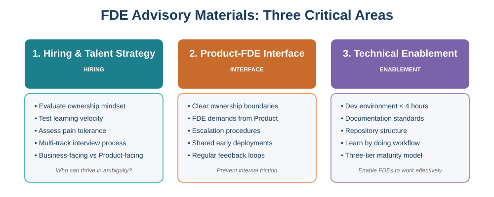

# FDE Advisory Materials

**The Platypus FDE Blueprint, and the open workbook beneath it.**

Forward Deployed Engineering is a product R&D function dressed up as a delivery function. An FDE owns a customer's outcome, builds whatever the product cannot yet do, and walks the bag of weird bricks back to the people who build the product. Whether you need that function, what shape it takes, and how you measure it are all downstream of two decisions most companies never make explicitly: **what problem is the field solving for the product**, and **where the compounding asset lives** — in a product you sell or a capability you keep. The Blueprint is a way of making those decisions on purpose, then designing the unit, the interfaces, the hiring bar and the measurements to match.

**Start with the ruler.** Read [The Platypus FDE Blueprint](blueprint.md) first — nine parts, twenty minutes. Everything else on this site is the workbook beneath it: the practice areas are the "how", and the templates are the parts you can run tomorrow.

These materials come from seven years running FDE teams at Palantir, 1,000+ technical interviews, and hands-on advisory work with companies building FDE functions from scratch.

> Published by [Platypus Technologies](https://platypustech.xyz). Platypus sells the Blueprint applied: the **FDE Readiness Assessment** — two weeks, ending in a written Readout of where your organisation sits on the maturity stages, which failure modes are live, and what the next ninety days should change — and the ladder of engagements above it. See [platypustech.xyz/engagements](https://platypustech.xyz/engagements/) or [get in touch](mailto:work@platypustech.xyz). Everything on this site is free under CC BY 4.0.

| Challenge | Solution |
|-----------|----------|
| **Not sure you need FDEs at all?** | [The Blueprint, Part 1](blueprint.md#part-1-the-reasoning-gate-do-you-need-fdes-at-all) — the reasoning gate — and the free [self-diagnostic](https://platypustech.xyz/self-diagnostic/) |
| **Just starting?** | [FDE Startup Kit](00-fde-startup-kit.md) — Get the essentials in one document |
| **Hiring FDEs?** | [Hiring Strategy](01-hiring-talent-strategy.md) — Interview process, evaluation criteria, scorecards |
| **FDE-Product friction?** | [Product Interface](02-product-fde-interface.md) — Clear ownership boundaries and escalation paths |
| **Environment issues?** | [Technical Enablement](03-technical-enablement.md) — Technical standards for FDE-ready products |
| **Running an FDE team?** | [FDE Operating Models](04-fde-operating-models.md) — Team structure, capacity planning, feedback loops |

---

## Why These Materials?

Most organizations trying to build FDE teams fail because they:

- **Skip the reasoning** — Copying a title from a job ad instead of deriving the role from a deployment problem
- **Hire wrong** — Using standard engineering interviews that miss FDE-specific traits
- **Structure wrong** — Unclear boundaries between FDE and Product teams
- **Enable wrong** — Products that aren't ready for field deployment

The Blueprint addresses the first. The practice areas and templates solve the other three with concrete processes, checklists and agreements that work.

> *"Featured in [The Pragmatic Engineer](https://newsletter.pragmaticengineer.com/p/forward-deployed-engineers) — the definitive deep-dive on Forward Deployed Engineering."*

---

## What is FDE?

Forward Deployed Engineering is **a product R&D function dressed up as a delivery function**. An FDE:

- **Owns the customer's outcome** — not hours, not tickets, not a statement of work
- **Builds whatever the product cannot yet do** — inside the customer's environment, with real data, on the customer's clock
- **Walks the bag of bricks back** — every hack, workaround and ugly-but-working build is product signal, and the loop that carries it back to the people who build the product is the whole point
- **Operates with autonomy set by product maturity** — root access at Stage 0, config approvals by Stage 3; the product moves the dial, not policy

Without the loop back to product, you have a very expensive consultancy in a t-shirt. The [Blueprint](blueprint.md) sets out when the function is justified, which of two paths it is on, and how to design and measure it.

---

## What's Included

### The Blueprint

- **[The Platypus FDE Blueprint](blueprint.md)** - The framework in nine parts: the reasoning gate, the fork, maturity stages, the atomic unit, the three interfaces, measurement, hiring, the eight failure modes, and how it is applied. Start here.

### Core Documents

  

- **[00-fde-startup-kit.md](00-fde-startup-kit.md)** - Quick reference guide for FDE essentials.
- **[01-hiring-talent-strategy.md](01-hiring-talent-strategy.md)** - How to hire FDEs (interview process, evaluation, channels)
- **[02-product-fde-interface.md](02-product-fde-interface.md)** - Managing FDE-Product team relationships and expectations
- **[03-technical-enablement.md](03-technical-enablement.md)** - Minimum standards for FDE-ready products
- **[04-fde-operating-models.md](04-fde-operating-models.md)** - How to run the day-to-day of an FDE function

### Resources

Ready-to-use [resources](resources/index.md) for building your FDE program:

- **Hiring**: Job descriptions, interview scorecards, hiring thesis template, onboarding checklists
- **Product Interface**: FDE-Product team agreements
- **Operations**: Operating model canvas

---

## What is here, and what is not

**Here:** the framework and the runnable templates — the Blueprint, the startup kit, the four practice areas, and the templates you can run tomorrow: the hiring loop design, the interface agreement, the onboarding checklist, the operating-model canvas. All of it is free under [CC BY 4.0](https://creativecommons.org/licenses/by/4.0/). Use it, adapt it, put it in your internal wiki; keep the name on it.

**Not here:** the calibrated interview exercises and their rubrics, the decomposition prompts with what-good-looks-like, the academy scenario packs, and the assessment scoring method. Those are licensed to clients inside engagements, and they will not be published — an interview exercise is only worth something while candidates have not seen it, and a scenario pack is only worth something while the firm next door does not have it.

The line is deliberate: the ruler is free with our name on it; the instruments are licensed; the measurement is what clients buy.

---

## Getting Started by Challenge

- **"Do we need FDEs at all, and which kind?"** → [The Blueprint](blueprint.md), Parts 1 and 2
- **"We need to hire our initial FDE team"** → [01-hiring-talent-strategy.md](01-hiring-talent-strategy.md)
- **"FDEs and Product teams are constantly in conflict"** → [02-product-fde-interface.md](02-product-fde-interface.md)
- **"FDEs spend days just trying to set up environments"** → [03-technical-enablement.md](03-technical-enablement.md)
- **"Our FDE team is running but we're not sure if the model is working"** → [04-fde-operating-models.md](04-fde-operating-models.md)
- **"I need a quick overview"** → [00-fde-startup-kit.md](00-fde-startup-kit.md)

---

## About the Author

**Anjor Kanekar** spent 7 years at Palantir as a Forward Deployed Engineer and hiring manager, building and scaling FDE teams across commercial and UK operations.

- **1000+ technical interviews** conducted and calibrated
- **Trained hundreds** of interviewers on FDE evaluation
- **Built hiring systems** that identified exceptional FDEs at scale
- **Featured in** [The Pragmatic Engineer](https://newsletter.pragmaticengineer.com/p/forward-deployed-engineers) on FDE organizations

Currently runs [Platypus Technologies](https://platypustech.xyz), where the Blueprint is applied to real organisations: readiness assessments, hiring systems, operating-model design and embedded delivery.

**Recent FDE Advisory Work:**

- [Prodigal](https://www.prodigaltech.com/) — Building an FDE organisation from the ground up
- [Northslope Technologies](https://www.northslope.tech/) — Built a bespoke FDE hiring framework ([case study](https://anjor.xyz/writing/2024/11/27/a-hiring-framework-for-a-new-kind-of-services-company/))
- [Comand AI](https://comand.ai/) — Designed the hiring process for FDE-style engineers ([case study](https://anjor.xyz/writing/2024/12/12/hiring-for-a-mission-driven-early-stage-startup/))
- Other clients held under the same discretion — see the [case notes](https://platypustech.xyz/case-notes/)

---

## Frequently Asked Questions

??? question "Is FDE the right model for my company?"

    Run the reasoning gate in [Blueprint Part 1](blueprint.md#part-1-the-reasoning-gate-do-you-need-fdes-at-all): name the deployment problem, decide which half of product-market fit you are missing, and ask what the cheapest structure is that solves it. FDE is the expensive answer; it is justified when there is genuine blank-canvas work and a product that will learn something from the answer.
    
    If your product is self-serve or requires minimal customisation, you need solutions engineers, and you should call them that. See also Barry McCardel's [critical perspective](https://www.barry.ooo/posts/fde-culture) on why most companies shouldn't adopt FDE.

??? question "How is FDE different from Solutions Engineering or Professional Services?"

    Key differences: FDEs **own customer outcomes** (not hours billed), **write production code** (not just configure), and **contribute upstream** to the product. Many "Solutions Engineers" are actually FDEs under different titles. The distinction matters for hiring and org design.

??? question "How many FDEs do I need to start?"

    Start with **2-3 FDEs** for your first cohort. This gives you peer support, coverage, and multiple data points on what works. A single FDE operating alone is high-risk — no one to learn from and high burnout risk.

??? question "Can I use these materials for my company?"

    Yes. Everything under `docs/` on this site is licensed [CC BY 4.0](https://creativecommons.org/licenses/by/4.0/): use it, adapt it, put it in your internal wiki, build your own process on it. The one condition is attribution — keep a line such as *"The Platypus FDE Blueprint © Platypus Technologies, CC BY 4.0"* with a link to [platypustech.xyz](https://platypustech.xyz) or this site on whatever you derive from it. See [LICENSE-DOCS.md](https://github.com/anjor/fde-advisory-materials/blob/main/LICENSE-DOCS.md) for the detail. Code in the repository remains MIT.

??? question "How do I get hands-on help building my FDE program?"

    [Platypus Technologies](https://platypustech.xyz) sells the Blueprint applied. The entry point is the **FDE Readiness Assessment**: two weeks, a written Readout. Above it sit hiring-system design, operating-model design, calibrated interviewing and embedded delivery. See [platypustech.xyz/engagements](https://platypustech.xyz/engagements/) or [get in touch →](mailto:work@platypustech.xyz)

---

## Stay Updated

Subscribe to updates and new versions:

- **GitHub Releases**: [Watch this repository](https://github.com/anjor/fde-advisory-materials) → Custom → Releases only
- **RSS Feed**: Subscribe to [releases feed](https://github.com/anjor/fde-advisory-materials/releases.atom)
- **Check manually**: View [CHANGELOG.md](CHANGELOG.md) for version history

Current version: **1.5.0** (updated 2026-09-01)

---

## Ready to Build Your FDE Team?

**Get hands-on help from someone who's done it:**

- 📧 [work@platypustech.xyz](mailto:work@platypustech.xyz) — Let's talk about your FDE program
- 💼 [linkedin.com/in/anjor-kanekar](https://linkedin.com/in/anjor-kanekar) — Connect for FDE insights
- 🌐 [platypustech.xyz](https://platypustech.xyz) — Full advisory services
